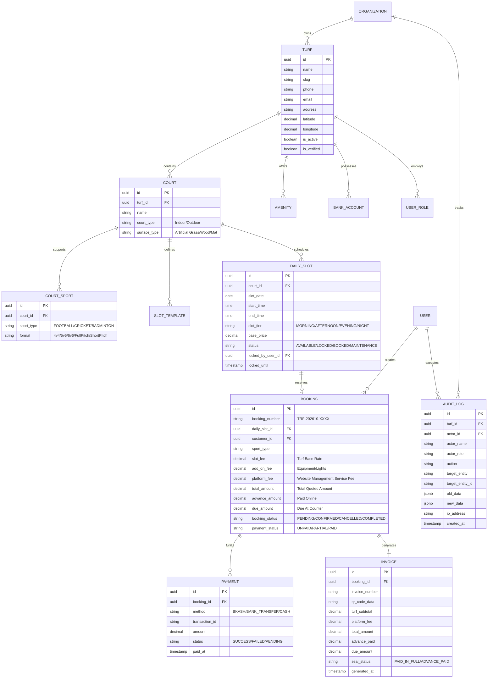

# TurfSync — Comprehensive Software Requirement Specification (SRS) & Requirement Analysis

**Document Version:** 1.0.0  
**Project Name:** Turf Management & Multi-Sport Booking Platform  
**Target Market:** Local Sports Turf Ecosystem (Football, Cricket, Badminton)  
**Date:** October 13, 2026  
**Status:** Approved / Base Specification  

---

## 1. Executive Summary & Problem Context

### 1.1 Background
The local sports culture (especially amateur football, tape-ball/box cricket, and indoor badminton) has exploded in metropolitan and suburban regions. However, turf operations operate almost entirely offline or informally via scattered social media pages and individual phone calls.

### 1.2 Core Problems Identified

| Stakeholder | Problem Description | Direct Business Impact |
| :--- | :--- | :--- |
| **Turf Owners** | Rely on verbal phone calls / WhatsApp chats without mandatory instant advance payments. | **High No-Show Rate:** Customers book verbal slots, fail to show up, leaving prime slots empty and causing 100% revenue loss for that hour. |
| **Turf Owners** | Manual paper/spreadsheet slot bookkeeping by shift counter boys. | **Booking Clashes & Double Bookings:** Two groups arrive at 8:00 PM on Friday, causing disputes, physical altercations, and severe brand damage. |
| **Customers / Players** | No centralized discovery. Players don't know what turfs exist in a 5km radius, their court sizes, or amenities (lockers, parking, cafe, lighting). | **Friction & Wasted Time:** Knocking 5 to 10 turf owners via phone/WhatsApp just to find one open 8:00 PM slot. |
| **Customers / Players** | Lack of price transparency and fluctuating peak prices without formal invoices. | **Lack of Proof:** Paying via personal bKash/Nagad send-money without automated receipts; conflicts over partial vs. full dues at the counter. |
| **Platform / Management** | Multiple staff/agents edit slot prices, schedules, and manual bookings at different shifts. | **Zero Accountability:** Unauthorized discounts, deleted slots, or accidental price overrides with no change logs or audit trails. |

---

## 2. User Roles & Permission Matrix (RBAC)

The system supports a hierarchical, role-based security model:

1. **Super Admin / Platform Owner**: Full control over platform-wide configurations, turf verification, commission/subscription models, platform dispute resolution, and system audit logs.
2. **Platform Support Agent**: Internal team members assisting turf onboarding, verification, customer disputes, and live support.
3. **Turf Owner / Organization Admin**: Owner of the physical facility. Has full rights over their turf profile, bank/bKash accounts, staff accounts, pricing templates, and analytics.
4. **Turf Manager / Counter Agent (Shift Staff)**: On-ground counter staff who can view slot calendars, check in arriving players, collect cash balance dues, or mark offline walk-in bookings. Cannot alter bank accounts or delete historical audits.
5. **Customer / Player**: End-users who search, compare, book, pay advance/full amounts, receive invoices, and communicate with turf admins.

---

## 3. Functional Requirements

### Feature 1: Turf Profile & Multi-Sport Facility Management
* **Basic Onboarding**:
  * Business Legal Name, Brand/Display Name.
  * Contact Mobile Number (primary counter and manager WhatsApp), Email.
  * Physical Address, Google Maps coordinates (Latitude, Longitude), Area / City (e.g., Dhanmondi, Gulshan, Uttara).
  * Facilities / Amenities checklist:
    * Changing Rooms & Lockers
    * Floodlights (Day/Night match certified)
    * Drinking Water / Beverage Kiosk
    * Cafeteria / Rest Area
    * Wi-Fi availability
    * Parking (Bikes / Cars)
    * Bibs, Balls & Equipment Rental
    * First Aid kit
* **Visual Media & Gallery Management (Photos & Videos)**:
  * **Photo Upload Policy**:
    * Maximum quota: **8 photos per turf facility**.
    * Permitted formats: **PNG, JPEG (`.png`, `.jpeg`, `.jpg`)** only. Other formats (e.g., GIF, WebP, BMP) are strictly rejected.
    * Features: High-res pitch condition preview, floodlight night shots, locker room photography, caption editing, and "Set as Main Cover" selection.
  * **Video Upload Policy**:
    * Maximum quota: **2 video clips per turf facility**.
    * Strict duration limit: **Maximum 30 seconds per video clip**. Video duration is verified automatically in the browser via HTML5 metadata prior to storage; any clip exceeding 30s is rejected.
    * Permitted formats: **MP4, WebM (`.mp4`, `.webm`)**.
    * Purpose: Action gameplay clips, ball bounce responsiveness test, and drone aerial 360 overview for players.
  * **Customer Lightbox & Public Showcase**:
    * Embedded on customer turf search cards and booking modal.
    * Interactive tabbed viewer (Photos / Videos) with fullscreen photo zoom and responsive HTML5 video playback.
* **Court & Multi-Game Architecture**:
  * A single turf facility can contain **one or multiple physical grounds/courts** (e.g., Ground A, Ground B, Court 1).
  * **Sport Compatibility Configuration**:
    * **Football**: Format options (4v4, 5v5, 6v6, 7v7, 8v8+), Turf surface type (Artificial Grass 40mm/50mm, Rubber infill).
    * **Cricket**: Full Pitch, Box/Short Pitch, Turf matting/carpet overlay, Cricket pads/gloves available.
    * **Football & Cricket Hybrid**: Shared court that can be converted depending on slot booking.
    * **Badminton**: Court layout (Synthetic Mat, Wooden Floor), Indoor, Height clearance.

---

### Feature 2: Standardized 1.5-Hour Match Slots & Capacity-Based Pricing Engine

1. **Standardized 1.5-Hour Match Duration (Fixed 90 Mins)**:
   * All matches and daily booking slots are standardized to fixed **1.5-hour durations** (90 minutes) across the entire platform.
   * Slot labels and display format strictly adhere to:
     `Slot X : Start - End` (e.g. `Slot 1 : 6 Am - 7:30 AM`).
   * **16 Standard Daily Slots (24-Hour Coverage Across 4 Shifts)**:
     * **Morning Shift (6:00 AM – 12:00 PM)**:
       - Slot 1 : 6 Am - 7:30 AM
       - Slot 2 : 7:30 Am - 9:00 AM
       - Slot 3 : 9:00 Am - 10:30 AM
       - Slot 4 : 10:30 Am - 12:00 PM
     * **Afternoon Shift (12:00 PM – 6:00 PM)**:
       - Slot 5 : 12:00 Pm - 1:30 PM
       - Slot 6 : 1:30 Pm - 3:00 PM
       - Slot 7 : 3:00 Pm - 4:30 PM
       - Slot 8 : 4:30 Pm - 6:00 PM
     * **Evening Shift (6:00 PM – 12:00 AM)**:
       - Slot 9 : 6:00 Pm - 7:30 PM
       - Slot 10 : 7:30 Pm - 9:00 PM
       - Slot 11 : 9:00 Pm - 10:30 PM
       - Slot 12 : 10:30 Pm - 12:00 AM
     * **Night Shift (12:00 AM – 6:00 AM)**:
       - Slot 13 : 12:00 Am - 1:30 AM
       - Slot 14 : 1:30 Am - 3:00 AM
       - Slot 15 : 3:00 Am - 4:30 AM
       - Slot 16 : 4:30 Am - 6:00 AM
2. **Fixed Slot Base Price**:
   * In standard operations, the base price per 1.5-hour slot is fixed by default for each ground.
3. **Ground Capacities & Pricing**:
   * A single Turf facility can operate **multiple grounds/courts** with varying player capacities:
     * **Ground A (5v5 Football / Short Cricket)**: Capacity ~10–12 players $\rightarrow$ e.g., ৳2,800 / 1.5h.
     * **Ground B (7v7 Football / Full Cricket Pitch)**: Capacity ~14–16 players $\rightarrow$ e.g., ৳4,200 / 1.5h.
     * **Ground C (Indoor Badminton Court 1 & 2)**: Capacity ~4 players $\rightarrow$ e.g., ৳1,500 / 1.5h.
     * **Others (Multi-Purpose / Training Area)**: Custom capacity & pricing.
   * Ground pricing directly correlates with physical court dimensions and player capacity.
4. **Ground Registration & Onboarding (Admin/Manager)**:
   * Turf managers or admins can **register new ground types** to their facility at any time:
     * Ground Name (e.g. Ground C, Rooftop Arena).
     * Sport Type (Football, Cricket, Badminton, Others) & Match Format (5v5, 6v6, 7v7, Box Cricket, etc.).
     * Physical Player Capacity (e.g. 10, 12, 14, 16 players).
     * Surface Material (Artificial Turf 50mm, Wooden, Synthetic Mat).
     * Standard 1.5-Hour Slot Pricing (৳).
     * Generates active daily 16-slot schedules automatically.
5. **Slot Timing & Price Modifications (Admin/Manager)**:
   * Turf management can adjust individual or batch **slot timings** (e.g., start time, end time).
   * Turf management can update **slot prices** (e.g. peak hours, special fixtures).
   * Turf management can recalibrate **pricing based on field capacity changes** (e.g., expanding court size from 10 to 12 players adjusts fixed 1.5h rate).
   * Every edit is logged in the append-only multi-agent audit trail with actor name, role, timestamp, and justification reason.

---

### Feature 3: Turf Location & Proximity Engine (Map Distance)

* **Customer Proximity Calculation**:
  * An interactive map view (Google Maps / OpenStreetMap integration) displaying the user's detected or chosen location (e.g. "Current Location: Dhanmondi 27").
  * Every turf card displays the exact driving/road distance (e.g., **"1.4 km away • 6 min drive"**, **"5.8 km away • 18 min drive"**).
  * Map pins show turf ground locations with real-time status badges, capacity tags, and "Directions" deep links.

---

### Feature 4: Payment Gateway, Multi-Slot Tiered Platform Fee, Custom Advance %, & Discounts

1. **Website Management Platform Fee (Single & Multi-Slot Tiered Formula)**:
   * **Single Slot**: Fixed at **৳200 (200 Taka)** if a player books 1 single slot.
   * **Multiple Slots**: If a customer books more than 1 slot in a single reservation:
     * **2 Slots**: **৳250** ($৳200 + ৳50 \times 1$)
     * **3 Slots**: **৳300** ($৳200 + ৳50 \times 2$)
     * **$N$ Slots**: **$৳200 + (N - 1) \times ৳50$** (beyond 1 single slot, ৳50 is added for every additional slot).
   * **Mathematical Formulation**:
     $$\text{Platform Fee}(N) = 200 + (N - 1) \times 50 \quad \text{BDT} \quad (\forall N \ge 1)$$
   * The platform fee is clearly itemized as a separate line item on both the customer checkout quote and the generated digital QR invoice.
2. **Custom Booking Advance Percentage (Set by Turf Management)**:
   * Each turf owner/manager configures their required online booking deposit percentage:
     * Configurable at **30%, 40%, 50%, or custom __%** of the gross slot price.
     * Example (Single 1.5h Slot @ ৳2,800 with 40% turf deposit requirement):
       - Turf Advance Deposit: $40\% \times ৳2,800 = ৳1,120$
       - Platform Fee (1 slot): ৳200
       - **Total Online Payment at Checkout: ৳1,320**
       - **Remaining Due at Turf Counter: ৳1,680**
     * Example (Double 1.5h Slots @ $2 \times ৳2,800 = ৳5,600$ with 40% turf deposit requirement):
       - Turf Advance Deposit: $40\% \times ৳5,600 = ৳2,240$
       - Platform Fee (2 slots): ৳250 ($৳200 + ৳50$)
       - **Total Online Payment at Checkout: ৳2,490**
       - **Remaining Due at Turf Counter: ৳3,360**
3. **Turf Discounts & Forced Counter Discounts**:
   * **Online Promo Discount**: Applied during checkout via coupon code or turf seasonal campaign.
   * **Forced / Manager Counter Discount**: Turf managers can apply a discretionary discount (e.g., ৳300 off due to rain, regular customer rebate, or counter cash settlement discount).
   * Discounts reduce the gross slot fee and automatically rebalance the counter due amount.
4. **Payment Gateways**:
   * Direct bKash Checkout (instant webhook) and Bank Transfer options for online advance/full payment.

---

### Feature 5: The 3 Dedicated Portals & Financial Analytics

The platform provides 3 completely segregated, role-tailored portals:

#### Portal 1: Customer Portal (Players)
* Discovery by map proximity/distance, sport (Football, Cricket, Badminton, Others), and ground capacity.
* Interactive 1h / 1.5h / 2h duration picker with real-time price re-calculation.
* Transparent quote: (Gross Slot Price) – (Discounts) + (৳200 Platform Fee) = Total.
* bKash payment gateway simulation & instant digital QR invoice.
* **Customer Financial Reports & Analytics**:
  * Lifetime turf expenditure analytics.
  * Breakdown of Online Advance vs Counter Cash paid.
  * Total platform fees paid (৳200 per match).
  * Total hours played and savings from discounts.

#### Portal 2: Turf Management Portal (Manager, Admin, Accounts)
* Multi-Ground management: define capacities (5v5, 7v7, Badminton, etc.) and fixed rates for 1h, 1.5h, 2h.
* Booking deposit policy setter: choose 30%, 40%, 50%, or custom % advance requirement.
* Discount manager: apply promotional or forced discounts on bookings.
* Counter Check-in & Cash Collection: scan player QR code and record cash due settlements.
* **Turf Financial Reports & Analytics**:
  * Total Gross Slot Revenue vs Total Discounts given.
  * Online bKash Advance collections vs Counter Cash collections.
  * Ground utilization rates & revenue breakdown per ground capacity.
  * Net Settlement Ledger with Platform Admin (reconciliation of advance collected online vs platform fees).

#### Portal 3: Platform Admin Portal (Platform Admin, Accounts, Manager)
* Platform-wide oversight of all verified turfs, bookings, and ground utilization across the city.
* **Platform Financial Reports & Analytics**:
  * Total Platform Revenue (Aggregate ৳200 booking fees).
  * Gross Merchandise Volume (GMV) of all turf transactions.
  * Turf Payout & Settlement Ledger: tracks money collected online, platform fee retention, and net payouts owed to each turf owner.
  * System-wide Multi-Agent Audit Log: filterable record of every price edit, discount applied, and cash collection across all turfs.
* **Instant Digital Invoice & PDF Generation**:
  * Generated immediately upon payment confirmation.
  * Unique Booking Reference (e.g., `TRF-202610-8492`) and Invoice Number (e.g., `INV-2026-000841`).
  * Cryptographic or Scannable **QR Code** for instant counter check-in.
  * Turf Details: Name, address, Google Maps link, emergency contact phone.
  * Game Details: Sport type, court name, date, start time, end time.
  * Itemized Financial Table:
    * Line Item 1: Turf Slot Booking (`Football 6v6 - Evening Slot`) — ৳2,500
    * Line Item 2: Add-on (Cricket Pitch Carpet & Pads) — ৳300
    * Line Item 3: **Platform Convenience Fee (Website Service Charge)** — ৳100
    * **Subtotal / Total Quoted**: ৳2,900
    * **Advance Paid (bKash trxID `BK872391X`)**: ৳1,000
    * **Due Balance at Counter**: ৳1,900
  * Status Visual Seal:
    * Green **"PAID IN FULL"** watermark stamp if 100% cleared.
    * Amber **"ADVANCE PAID — DUE BALANCE ৳1,900"** banner if partially paid.
* **Receipt Delivery**:
  * Instant download in web app.
  * Automated SMS confirmation with short link.
  * Automated WhatsApp notification with PDF attachment / receipt link.

---

### Feature 6: Communication Hub

1. **In-App Live Chat**:
   * Real-time WebSocket / Pusher chat between Customer and Turf Admin/Agents.
   * Direct context-attached chat (e.g., customer clicks "Ask Question" on a specific slot or turf listing).
2. **WhatsApp Direct Gateway**:
   * Floating WhatsApp widget with pre-filled message:
     * *"Hello [Turf Name], I am inquiring about booking [Sport] on [Date] at [Time] (Booking ID: ...)."*
   * Website Platform Admin Hotline number for support/escalation.

---

### Feature 7: Multi-Agent Audit Log & Historical Change Tracking

Because multiple turf managers, counter boys, and platform agents can alter slot statuses, pricing, cancellations, and bank details at different times, the system must maintain an **immutable audit log**.

#### 7.1 What Must Be Logged:
* **Slot Price Changes**: Who changed Friday 8 PM slot from ৳2,500 to ৳3,000, previous value, new value, timestamp, agent IP.
* **Manual Slot Blocks / Overrides**: Who marked a slot as "Maintenance" or "Walk-in Booked".
* **Manual Payment Dues Settlement**: When counter staff marks a remaining ৳2,000 cash due as "Received".
* **Booking Cancellations & Rescheduling**: Agent ID, reason for cancellation, refund amount processed.
* **Turf Configuration Changes**: Bank details update, court dimension modifications, operating hours changes.

#### 7.2 Audit Log Structure
```json
{
  "log_id": "aud_98412894172",
  "turf_id": "trf_001",
  "actor_id": "usr_agent_42",
  "actor_name": "Robiul Islam (Counter Shift A)",
  "actor_role": "TURF_MANAGER",
  "action": "SLOT_PRICE_UPDATED",
  "entity_type": "SLOT_TEMPLATE",
  "entity_id": "slot_fri_1900",
  "timestamp": "2026-10-14T14:32:00Z",
  "ip_address": "103.145.22.18",
  "changes": {
    "field": "base_price",
    "old_value": 2500,
    "new_value": 3000,
    "reason": "Govt Holiday Surge Pricing"
  }
}
```

---

## 4. Technical Architecture & Data Model

### 4.1 Recommended Tech Stack
* **Frontend**: Next.js 15 (React 19, TypeScript, Tailwind CSS, Lucide Icons, Shadcn UI).
* **Backend API**: Node.js / NestJS or Next.js App Router API with Server Actions + Zod Validation.
* **Database**: PostgreSQL (Prisma ORM or Drizzle ORM) with PostGIS extension for geo-location proximity queries (`ST_DWithin`).
* **Cache & Locks**: Redis (for 10-minute slot checkout concurrency locks and session storage).
* **Payment Gateways**: bKash Tokenized/Checkout API, SSLCOMMERZ / Shurjopay fallback.
* **Realtime**: Socket.io or Supabase Realtime for live chat and live slot calendar updates.
* **Document Generation**: `@react-pdf/renderer` or `puppeteer-core` for server-side PDF invoice rendering.

---

### 4.2 Entity Relationship Diagram (ERD Schema)



---

## 5. Screen Layouts & User Flow Wireframe Specifications

### 5.1 Player / Customer Journey
1. **Home / Discovery Page**:
   * Search banner: City/Area dropdown, Sport selector (Football, Cricket, Badminton), Date picker, Time preference (Morning, Afternoon, Evening, Night).
   * Filter sidebar: Distance (km), Price range (৳/hour), Amenities (Lockers, Parking, Floodlights, Cafe), Ground format (5v5, 6v6).
   * Turf cards with verified badges, ratings, starting prices, and "Quick Book" action.
2. **Turf Detail & Interactive Slot Matrix**:
   * Photo gallery, map location, amenity tags.
   * Day selector (Today, Tomorrow, Fri, Sat...).
   * **Visual Slot Grid (4 Tiers)**:
     * Green = Available
     * Grey = Already Booked
     * Yellow = Locked / Processing
   * Click slot $\rightarrow$ Select sport type (Football 5v5 vs Cricket) $\rightarrow$ Displays dynamic price.
3. **Checkout & Payment**:
   * Selection summary & timing.
   * Choose Payment:
     * Option A: Pay Full Amount (৳3,000)
     * Option B: Pay Advance Deposit (৳1,000) — Balance ৳2,000 due at ground.
   * Payment selector: bKash Gateway (instant popup) or Bank Transfer (slip upload).
4. **Instant Invoice Screen**:
   * Visual receipt with Stamp ("PAID" or "ADVANCE RECEIVED").
   * Download PDF button.
   * WhatsApp share button.
   * "Add to Google Calendar" button.

---

### 5.2 Turf Management / Owner Dashboard
1. **Live Ground Control Board**:
   * Daily calendar timeline view of courts (similar to hotel room rack / calendar grid).
   * Real-time slot status toggle (Block for maintenance, walk-in cash booking, price tweak).
2. **Slot Pricing & Template Manager**:
   * Weekly template builder (Set Monday 6am-12pm = ৳1,800, Friday 6pm-12am = ৳3,500).
   * Holiday surge rule configuration.
3. **Cash Balance & Counter Check-In**:
   * QR scanner to scan arriving player's invoice.
   * Displays "Due ৳2,000" $\rightarrow$ Counter agent clicks "Received Cash ৳2,000" $\rightarrow$ Changes invoice to "Fully Cleared" and logs the agent ID.
4. **Audit Trail & Activity Log**:
   * Filterable table: Date range, Agent name, Event type (Price change, Slot override, Refund).
   * Expandable JSON diff view showing exact changes before and after.

---

## 6. Implementation Phasing & Milestones

* **Phase 1: Core Engine & Multi-Sport Database (Week 1–2)**
  * Database schema setup, Prisma migrations, multi-sport format definition.
  * Slot generator engine (automatic generation of daily slots across the 4 tiers).
* **Phase 2: Turf Admin & Slot Configuration (Week 3–4)**
  * Turf onboarding, court management, amenity tagging.
  * Dynamic pricing rules, holiday calendar, manual slot blocking.
  * Multi-agent Role-Based Access Control and immutable Audit Log subsystem.
* **Phase 3: Customer Booking, Anti-Clash & Payment (Week 5–6)**
  * Geo-location search and filtering.
  * Redis-backed 10-minute temporary slot reservation engine.
  * bKash Checkout PGW integration with automated webhooks.
* **Phase 4: Invoicing, Communication & Deployment (Week 7–8)**
  * PDF Invoice generator with QR code and Paid/Due seal.
  * In-app live chat and WhatsApp trigger integration.
  * Production deployment, mobile responsive QA, and performance tuning.

---

## 7. User Interface Theming: Dark Mode & Light Mode Suite

To accommodate late-night turf bookings (common for 8 PM - 2 AM slots) as well as bright outdoor daylight administrative use:
1. **Dark Mode (Default)**:
   * Slate-950 (`#020617`) canvas with deep slate-900 surfaces and emerald green (`#10b981`) stadium pitch accents.
   * Reduces eye strain during evening searches and aligns with modern sports gaming aesthetic.
2. **Light Mode**:
   * Slate-50 (`#f8fafc`) canvas with pure white card surfaces, soft slate-200 dividing borders, and deep emerald text (`#047857`) for optimal outdoor daylight legibility and WCAG AAA compliance.
3. **Instant Toggle & State Persistence**:
   * Header Sun ☀️ / Moon 🌙 toggle icon.
   * Automatically persists user preference in `localStorage` (`turfsync_theme`).

---

## 8. Enterprise Version 3.0 Upgrades (8 Core Business Modules)

### 8.1 Module 1: Social Media Referral Registration & Mobile OTP Verification
- **Trigger**: Landing page detects `?ref=social`, `?source=facebook`, `?source=instagram` or clicking the top referral bar.
- **Workflow**: Prompts user (Player or Turf Manager) to register with Name, Email, Mobile Number, and Location.
- **OTP Engine**: Generates a 4-digit verification code (`4829`) and starts a 60-second countdown timer.
- **Security Goal**: Verifies real telephone contact before granting booking/reservation privileges, eliminating fraudulent no-shows.

### 8.2 Module 2: User-Specific Login Portals & Session Control
- **Customer Portal**: Player login, match slot discovery, bKash partial deposit checkout, invoice QR access, and expenditure analytics.
- **Turf Management**: Shift desk login, multi-ground capacity management, slot schedule manager, front desk check-in, counter cash due collection, and media gallery manager.
- **Platform Management (Super Admin)**: Headquarters login, multi-venue directory, user management, promo code engine, immutable trash log, and platform fee reconciliations.
- **Header State**: Displays current authenticated session persona, role badge, neighborhood/facility, with one-click switching and logout.

### 8.3 Module 3: Streamlined UX & Redundant Data Elimination
- Removal of repetitive guide bars, duplicate explainer cards, and redundant secondary switcher components.

### 8.4 Module 4: Web Portal User Administration & Audit Trash Log
- **Super Admin Authority**: Add and delete turf facilities and customer accounts.
- **Mandatory Justification**: Deletions mandate entering a compliance/business reason.
- **Trash Log Subsystem**: Permanent audit table recording Record Type (`TURF_FACILITY` vs `CUSTOMER`), Record Name & ID, Reason, Deleted By, IP address, and Timestamp.

### 8.5 Module 5: Platform Promo Codes with Percentage Discount & Max Cap
- **Promotion Model**: Admin configures % discount targeting either Platform Fee or Total Booking.
- **Cap Protection**: Strict ceiling amount in BDT (e.g. 50% discount capped at ৳100).
- **Calculation Formula**:
  $$\text{Applied Discount} = \min\left(\text{Gross Base} \times \frac{\text{Percent}}{100},\; \text{Max Cap BDT}\right)$$
- **Active Promos**: `PLAY50` (50% fee off, cap ৳100), `SUPER25` (25% booking off, cap ৳500), `FREEFEE` (100% waiver, cap ৳300).

### 8.6 Module 6: Player & Turf Proximity Location Engine
- **Dhaka Neighborhoods**: Dhanmondi, Gulshan, Banani, Uttara, Mirpur, Bashundhara, Mohammadpur, Motijheel.
- **Haversine Geodesic Math**: Recalculates driving distances (`km`) and driving duration (`mins`) dynamically to all venues when a customer changes their neighborhood.

### 8.7 Module 7: Ground-Specific / Sports Field Independent Slot Schedules
- Master dictionary `groundSchedules[groundId]` stores dedicated 16-slot daily schedules for each individual ground (e.g. Ground A 5v5, Ground B 7v7, Court C Badminton).
- Booking slot 2 on Ground A leaves slot 2 on Ground B completely available.

### 8.8 Module 8: Redesigned Counter Desk Check-In & Revenue Recognition
- **Arrival Queue & Dossier**: Match arrival desk allows searching player booking by reference (`TRF-202610-101`) or invoice #.
- **Cash Due Settlement**: Desk confirms player arrival, collects remaining balance in cash, marks booking **COMPLETED / PAID IN FULL**, and stamps invoice.
- **Ledger Revenue Recognition**: Automatically recognizes revenue in both Turf Financial Ledger and Platform GMV Accounts with full audit logging.

### 8.9 Module 9: Emergency Maintenance, Slot Disabling & Day-Closure Management (Requirement 10)
- **Problem Context**: Extreme rainfall and waterlogging, floodlight failure, pitch turf carpet tearing, municipal strikes, or private whole-day tournament bookings necessitate immediate closure of individual slots, specific courts, or the entire sports venue on specific calendar dates.
- **Calendar & Specific Date Selector**:
  - Interactive Date Picker (`<input type="date">`) and 7 quick-date selector chips (Today, Tomorrow, upcoming weekdays).
  - Storage architecture: `dailyGroundSchedules[groundId__dateIso]` maintains distinct slot occupancy, bookings, and maintenance states for each separate calendar date.
  - Management can pick any specific future date from the calendar (e.g. Friday 16 Oct) and manage that date's slots independently without affecting other dates.
- **Slot-by-Slot Fast Control Rack & Bulk Matrix**:
  - **Visual 16-Slot Rack**: Responsive card matrix displaying all slots with timing, rates, and live status badges (`OPEN`, `MAINTENANCE`, `CLOSED`, `BOOKED`).
  - **1-Click Slot Toggle**: Instant toggle button on each tile to immediately flip between `OPEN` and `CLOSED` (or `MAINTENANCE`) with automatic audit logging.
  - **Bulk Action Toolbar**: Select All checkbox, "Disable Selected" (with dynamic count badge), and "Open Selected" (with dynamic count badge). Legacy morning/evening batch toggles eliminated in favor of direct multi-select precision.
- **Ground & Facility Whole-Day Closure Engine**:
  - Modal with 4 operational scopes:
    1. `CLOSE_GROUND`: Sets all available slots of the selected sports field on the chosen calendar date to `MAINTENANCE`.
    2. `CLOSE_ALL_GROUNDS`: Sets all available slots across all sports fields on the chosen calendar date to `MAINTENANCE`.
    3. `REOPEN_GROUND`: Restores all maintenance/closed slots of the selected ground back to `AVAILABLE`.
    4. `REOPEN_ALL`: Restores all grounds and slots across the venue to `AVAILABLE`.
  - Standardized incident categories: Severe Weather & Waterlogging, Pitch Grass Infill & Leveling, Emergency Floodlight Repair, Public Holiday / Strike, Private Tournament Reservation, Deep Cleaning & Disinfection.
- **Customer Awareness & Booking Modal Calendar**:
  - Customer Booking Modal features a **Match Date Picker** and quick-day chips, syncing with the selected date's live availability.
  - If a slot is disabled by management for that calendar date, customers see it disabled with amber `🛠️ Maintenance` or rose `🚫 Closed` badges and cannot select it.
  - Confirmed bookings persist to the customer's selected match date with accurate ticket invoices.
- **Multi-Agent Audit Trail**:
  - Every maintenance disable, re-open, ground closure, and facility shutdown is immutably logged under `MAINTENANCE` in the system audit log with actor ID, IP address, timestamp, calendar date, and affected slot diff.

### 8.10 Module 10: 4×4 Segment Matrix Layout for Standard 16 Match Slots (Single-View Booking)
- **Problem Context**: With standard 16 match slots (1.5 hours each across 24 hours), previous 1-column or 2-column list designs caused excessive vertical scrolling (>1,200px height), hiding the quote breakdown and forcing players to scroll repeatedly to view night and evening slots.
- **4×4 Matrix Architecture**:
  - The 16 standard match slots are partitioned into **4 natural diurnal segments of 4 slots each** (4 columns $\times$ 4 rows = 16 slots):
    1. **Segment 1 • Morning (6:00 AM – 12:00 PM)**: Slots 1, 2, 3, 4
    2. **Segment 2 • Afternoon (12:00 PM – 6:00 PM)**: Slots 5, 6, 7, 8
    3. **Segment 3 • Evening (6:00 PM – 12:00 AM)**: Slots 9, 10, 11, 12
    4. **Segment 4 • Night / Dawn (12:00 AM – 6:00 AM)**: Slots 13, 14, 15, 16
- **Single-View Compact Card Design**:
  - Slot card height reduced to ~62px with compact padding (`p-2 sm:p-2.5 rounded-xl`).
  - Line 1: `Slot N` + pulse dot indicator + micro status badge (`Available`, `✓ Selected`, `Booked`, `🛠️ Maint`, `🚫 Closed`).
  - Line 2: High-contrast match time (`6:00 AM – 7:30 AM`).
  - Line 3: Segment / duration indicator (`Morning`) + fixed slot rate (`৳2,800`).
  - Full width segment headers span all 4 columns (`col-span-2 md:col-span-4`) with distinct icons (`🌅`, `☀️`, `🌇`, `🌙`) and color-coded labels.
- **4×4 Segment Switcher & Quick Navigation**:
  - Interactive filter pills above the grid: `All 16 Slots (4×4 Matrix)`, `🌅 Morning (1–4)`, `☀️ Afternoon (5–8)`, `🌇 Evening (9–12)`, `🌙 Night (13–16)`.
  - Default view displays all 16 slots organized in the 4×4 segments in a single view with zero scrolling required on standard desktop viewports.
- **Modal Streamlining**:
  - Streamlined Ground selector and Duration indicator into compact headers to preserve screen real estate.
  - Retains all multi-slot selection, dynamic platform fee calculation (৳200 base + ৳50/additional slot), and discount engine capabilities.
  - 100% theme-adaptive: full light mode and dark mode high-contrast CSS styling.

### 8.11 Module 11: Lucrative 14-Day Date Carousel, Non-Scrolling Multi-Slot Selection & Streamlined Fast Control Rack
- **Non-Scrolling Multi-Slot Selection Experience**:
  - **Zero Viewport Jump**: Selecting or deselecting match slots inside the 4×4 matrix calculates the financial breakdown silently (`calculateQuote(false)`) without auto-scrolling the user down to the `#quote-card` section. Players remain fully anchored in the grid to pick multiple slots smoothly.
  - **Sticky Quick Selection Action Bar (`#modal-quick-selection-bar`)**:
    - Permanently anchored at the base of the booking modal once $\ge 1$ slot is selected.
    - Displays live reactive metrics: Selected Slot Count (`N slots selected`), Total Duration (`X.X hrs duration`), 30% bKash Advance Due (`৳XXXX advance`), and Total Estimated Booking Amount.
    - Includes a prominent high-contrast **"Review Quote & Pay"** call-to-action button that smoothly scrolls (`scrollToQuoteBreakdown()`) the player to the final payment and promotional code section only when they are ready.
- **Lucrative 14-Day Interactive Day Cards Carousel (Customer & Turf Portals)**:
  - **High-Impact Day Cards (`.date-tile`)**:
    - Replaces static date dropdowns with a 14-day horizontal carousel displaying:
      - Weekday header badge (`TODAY`, `TMRW`, `MON`, `TUE`, etc.) with golden amber weekend badges (`FRI`, `SAT`) tailored for Bangladesh prime sports days.
      - Prominent large calendar day number (e.g., `14`, `15`, `16`).
      - Abbreviated month and year label (`OCT`, `NOV`).
      - Active selection glow: emerald gradient (`from-emerald-500 to-emerald-600`) with high-contrast bold white typography.
  - **Smooth Horizontal Navigation**:
    - Left and right chevron scroll controllers (`‹` `›`) facilitating 220px step-wise horizontal navigation.
    - Full native calendar picker button (`<input type="date">`) for selecting dates beyond the 14-day quick window.
  - **Turf Management Closure Awareness**:
    - Day Cards in the Turf Management calendar bar query `dailyGroundSchedules[groundId__dateIso]` to display a bright red pulse dot (`🔴`) on any upcoming date that has active maintenance closures or disabled slots, providing instant facility-wide awareness across 2 weeks.
- **Streamlined Turf Fast Control Rack Toolbar**:
  - Removed obsolete "Close Morning" and "Close Evening" bulk buttons to prevent unintended wide closures.
  - Interactive **"Select All"** toggle checkbox with responsive dynamic label (`Select All (16)`).
  - High-visibility **"Disable Selected"** button with dynamic selection badge (`#rack-selected-count-badge-disable`).
  - High-visibility **"Open Selected"** button with dynamic selection badge (`#rack-selected-count-badge-open`).
  - Live reactive event listener `updateRackToolbarCounts()` instantly reflects checked slot tallies in both action buttons.

### 8.12 Module 12: Calendar-Driven Slot Availability, Segment Color Coding, Payouts Hub, Audit Trails & Customizable Slot Pricing
- **Calendar-Driven Slot Availability & Bookings State Engine**:
  - Direct, prominent date picker input (`#turf-schedule-date-input`) and "Pick Date" action button invoking native calendar picker via `openTurfDatePicker()`.
  - Multi-date schedule repository: `dailyGroundSchedules[groundId__dateIso]` tracks distinct slot states (Available, Booked, Maintenance, Closed) across calendar dates.
  - Multi-date seeded occupancy: Seeded schedules across upcoming dates (Today Oct 14, Tomorrow Oct 15, Friday Oct 16 weekend, Saturday Oct 17, Sunday Oct 18) and deterministic scheduling for any arbitrary future calendar selection ensure that clicking any date reveals authentic slot occupancy.
- **Fast Control Rack Diurnal Segment Colors & Time-Only Layout**:
  - **4 Diurnal Color Schemes**:
    - **Morning (Slots 1–4, 6 AM – 12 PM)**: Warm Amber theme (`border-amber-500/40 bg-amber-950/20 text-amber-300`, badge `🌅 Morning`).
    - **Afternoon (Slots 5–8, 12 PM – 6 PM)**: Sky Blue theme (`border-sky-500/40 bg-sky-950/20 text-sky-300`, badge `☀️ Afternoon`).
    - **Evening (Slots 9–12, 6 PM – 12 AM)**: Twilight Purple theme (`border-purple-500/40 bg-purple-950/20 text-purple-300`, badge `🌇 Evening`).
    - **Night (Slots 13–16, 12 AM – 6 AM)**: Midnight Indigo theme (`border-indigo-500/40 bg-indigo-950/20 text-indigo-300`, badge `🌙 Night`).
  - **Clear Start & End Times**: High-contrast, unambiguous breakdown (`Start Time: 6:00 AM`, `End Time: 7:30 AM`).
  - **Price Removal**: Price per slot is completely removed from the Fast Control Rack cards to eliminate visual clutter and keep manager attention on operations and availability.
- **User-Friendly Turf Payouts & Settlement Hub**:
  - Executive KPI summary cards: Gross Online Advance Held, Platform Fees Retained (৳200/slot), Ready for Disbursement (Pending Escrow), and Total Settled & Disbursed.
  - Interactive Filter & Search: Text search across turf names, bank accounts, and settlement IDs; status tabs for All, Pending, Processing, and Disbursed.
  - Actionable settlements table: Beneficiary venue details, bank account / bKash merchant info, period, match count, and net payable.
  - **Release Payout Modal**: Authorizes fund transfers via bKash Merchant B2B Disburse API or Bank BEFTN/NPSB with transaction reference ID.
  - **Itemized Settlement Voucher Modal**: Complete breakdown voucher suitable for printing or record-keeping.
  - Batch payout execution and CSV export.
- **User-Friendly Multi-Agent Audit Trails**:
  - Real-time text search across actor, target, diff, reason, and IP.
  - Category selector (`PRICING`, `SETTLEMENT`, `MAINTENANCE`, `REVENUE`, `DELETION`, `PROMOTIONS`, `AUTH`, `FACILITY`) and Role filter (`SUPER_ADMIN`, `TURF_ADMIN`, `TURF_MANAGER`, `TURF_COUNTER`, `PLAYER`).
  - Before $\rightarrow$ After comparison visualizer displaying old vs. new values in color-coded comparison chips.
  - JSON Compliance Payload Inspector modal and JSON export.
- **Customizable Slot Pricing & Market Capturing Strategy**:
  - Ground-specific rate configuration: Platform Admin can select any turf facility and sports court/ground to adjust pricing.
  - **1-Click Strategy Presets**:
    1. *Aggressive Market Penetration*: -25% discount across all 16 slots to outcompete local rival turfs.
    2. *Off-Peak Utilization Drive*: Heavy discounts on Morning (৳1,800) and Night (৳2,000) slots.
    3. *Prime Evening Surge*: +15% surge on evening slots (6 PM – 12 AM) for peak tournament days.
    4. *Reset to Baseline*: Restores official default base rates.
  - Diurnal segment base rate inputs and granular 16-slot customizer for individual slot rate overrides.
  - Live synchronization with Customer Booking Modal, quotes, invoices, and immutable audit logging.
